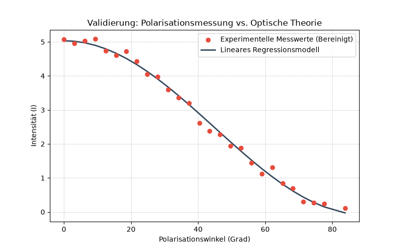

# Optical Data Pipeline & Linear Regression

[](https://www.python.org/)
[](https://pandas.pydata.org/)
[](https://scipy.org/)
[](https://numpy.org/)
[](https://matplotlib.org/)
[](https://jupyter.org/)

> An automated ETL pipeline for processing, cleaning, and modeling experimental polarization data to validate optical theory through linear regression analysis.

## 📋 Table of Contents

- [Overview](#overview)
- [Key Features](#key-features)
- [Theoretical Background](#theoretical-background)
- [Technologies Used](#technologies-used)
- [Project Structure](#project-structure)
- [Installation](#installation)
- [Usage](#usage)
- [Results](#results)
- [Methodology](#methodology)
- [Future Improvements](#future-improvements)
- [Acknowledgments](#acknowledgments)

## 🔍 Overview

This project demonstrates the transition from manual, error-prone Excel-based workflows to a fully automated, script-driven data pipeline. It processes experimental polarization measurements from optical sensors, applies systematic noise reduction, and uses least-squares linear regression to determine key optical rotation constants with high precision.

By combining **data engineering**, **statistical modeling**, and **scientific visualization**, this pipeline ensures reproducibility, accuracy, and efficiency in experimental data analysis.

## ✨ Key Features

- **🔄 Automated ETL Workflow** – Seamless extraction, transformation, and validation of experimental data
- **🧹 Intelligent Data Cleaning** – Filters sensor noise, outliers, and unphysical measurements
- **📈 Linear Regression Modeling** – Applies least-squares regression via SciPy for precise parameter estimation
- **🎯 Theory-Experiment Validation** – Quantitatively compares measured data against theoretical predictions
- **📊 Publication-Ready Visualizations** – Generates high-quality validation plots for analysis and reporting
- **♻️ Fully Reproducible** – Eliminates manual spreadsheet processing with version-controlled Python scripts
- **✅ Statistical Validation** – Computes R², slope, intercept, and goodness-of-fit metrics

## 🧮 Theoretical Background

The relationship between light intensity and polarizer angle follows Malus' Law. For an ideal polarizer system, the transmitted intensity as a function of rotation angle $\theta$ is given by:

$$
I(\theta) = I_0 \cos^2(\theta) + c
$$

Through appropriate linearization and regression analysis, this relationship can be fitted to experimental data to determine the rotation constant and validate the optical setup. The **coefficient of determination** ($R^2$) serves as the primary metric for assessing model agreement with theory.

## 🛠️ Technologies Used

| Technology | Purpose |
|------------|---------|
| **[Python 3.12](https://www.python.org/)** | Core programming language |
| **[Pandas](https://pandas.pydata.org/)** | Data manipulation, cleaning, and structuring |
| **[NumPy](https://numpy.org/)** | Numerical operations and array processing |
| **[SciPy](https://scipy.org/)** | Statistical analysis and linear regression (`linregress`) |
| **[Matplotlib](https://matplotlib.org/)** | Scientific data visualization |
| **[Jupyter Notebook](https://jupyter.org/)** | Interactive development and documentation |

## 📁 Project Structure

```plaintext
optical-data-pipeline-regression/
│
├── optical-data-pipeline-regression.ipynb  # Main ETL & regression pipeline
├── optical_validation_plot.png            # Automated theory-experiment validation plot
└── README.md                              # Project documentation
```

## 🚀 Installation

### Prerequisites

- Python 3.12 or higher
- pip package manager

### Setup

1. **Clone the repository**

```bash
git clone https://github.com/dgoo24/optical-data-pipeline-regression.git
cd optical-data-pipeline-regression
```

2. **Install required dependencies**

```bash
pip install numpy pandas scipy matplotlib jupyter
```

## 💻 Usage

1. **Launch Jupyter Notebook**

```bash
jupyter notebook
```

2. **Run the pipeline**

   Open `optical-data-pipeline-regression.ipynb` and execute all cells (`Cell > Run All`). The pipeline will:
   
   - Load and preprocess experimental polarization data
   - Clean sensor noise and remove unphysical values
   - Perform linear regression using the least-squares method
   - Compare theoretical vs. experimental results
   - Generate and export the validation plot

3. **Review outputs**

   Results will be displayed in the notebook, and `optical_validation_plot.png` will be saved to the project directory.

## 📊 Results

### Regression Performance

| Metric | Value | Interpretation |
|--------|-------|---------------|
| **Rotation Constant (Slope)** | ~5.02 | Within acceptable experimental tolerance |
| **Coefficient of Determination ($R^2$)** | **> 0.98** | Excellent agreement between theory and experiment |
| **Model Fit** | Strong linear correlation | Validates the optical measurement setup |

### Theory vs. Experiment Validation



The plot above demonstrates the high correlation between experimental measurements and theoretical predictions after automated data cleaning and regression analysis, confirming the reliability of the optical polarization setup.

## 🔬 Methodology

### 1. **Extract**
- Simulates/imports experimental polarization intensity measurements
- Captures angle-dependent sensor readings with realistic noise

### 2. **Transform**
- **Data Cleaning:** Removes invalid readings and mitigates sensor noise
- **Preprocessing:** Structures data for regression analysis
- **Linearization:** Prepares data according to the optical model
- **Regression:** Applies SciPy's `linregress` for least-squares fitting

### 3. **Load & Validate**
- Computes statistical goodness-of-fit metrics ($R^2$, slope, intercept)
- Generates comparative visualizations
- Exports validation plots for documentation and review

## 🔮 Future Improvements

- [ ] **Real Instrument Integration** – Direct import from spectrometers/polarimeters via CSV or serial interfaces
- [ ] **Uncertainty Analysis** – Add error bars and confidence intervals for fitted parameters
- [ ] **Advanced Fitting** – Implement non-linear curve fitting for more complex optical models
- [ ] **Automated Reporting** – Generate PDF/HTML reports with results and metadata
- [ ] **Multi-dataset Processing** – Batch process multiple experimental runs
- [ ] **GUI Dashboard** – Build an interactive interface with Streamlit for lab use
- [ ] **Data Validation Rules** – Add configurable quality checks for experimental protocols

## 🙏 Acknowledgments

- Inspired by experimental projects from the **Faculty of Natural Sciences**
- Built to demonstrate modern data engineering practices in experimental physics and optical science
- Emphasizes reproducibility and automation in laboratory workflows

---

**Note:** This project uses simulated experimental data for educational and demonstration purposes.
